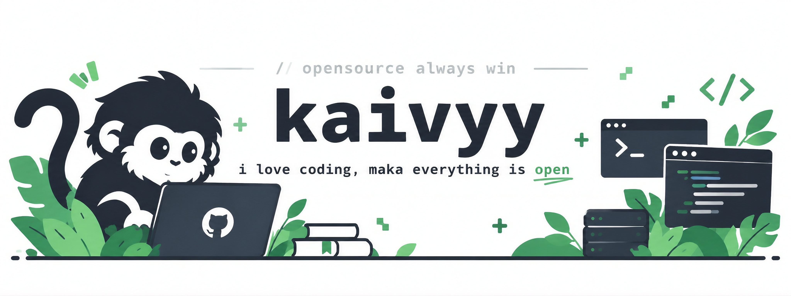

<div align="center">



# Kaivy Labs

Systems architecture, autonomous agent infrastructure, reverse engineering, and embedded telemetry.

</div>

---

## About

Kaivy Labs is an independent engineering workspace dedicated to building software from fundamental principles. The work spans autonomous agent runtimes, low-level protocol engineering, automotive control unit calibration, and resilient self-hosted infrastructure.

The core approach prioritizes minimal runtime dependencies, deterministic execution, and tooling that remains fully functional in local or network-constrained environments.

---

## Core Focus Areas

### Autonomous Agent Runtimes & Code Security
- **Stateful Memory Systems:** Developing persistent hybrid memory models for autonomous coding agents, reducing hallucinations and maintaining context across long execution horizons.
- **Protocol Integration:** Implementing Model Context Protocol (MCP) servers and OpenAI-compatible proxy layers to bridge local environments and proprietary models.
- **Agentic Security Tooling:** Static analysis and vulnerability assessment engines designed specifically for autonomous agents auditing multi-language codebases.

### Systems, Telemetry & Embedded Platforms
- **Automotive Calibration:** Binary extraction, checksum verification, and table definition generation for engine control units (ECU) across diverse OEM architectures.
- **Sensor Fusion & Navigation:** Dead reckoning systems, inertial sensor integration, and offline topographic rendering engines for environments where GNSS signals fail.
- **Biometric Telemetry:** Local ingestion pipelines that capture health and training telemetry directly from wearable devices for automated analytical processing.

### Protocol Reverse Engineering & Networking
- **Binary & Memory Forensics:** Analyzing firmware dumps, closed network protocols, and containerized runtimes using disassemblers and headless capture tools.
- **Payment & FinTech Protocols:** High-throughput parsers implementing EMVCo CRC16 standards for dynamic QRIS generation and automated transaction settlement.
- **Real-Time Media Pipelines:** Browser-based WebRTC surveillance dashboards featuring custom WebGL shaders for hardware-accelerated super-resolution.

---

## Engineering Principles

1. **Explicit Data Flow:** Avoid hidden abstractions and opaque state machines. Prefer simple data transformations that can be inspected at byte level.
2. **Offline-First Resilience:** Applications must degrade gracefully without active internet connections, relying on local caching, SQLite storage, and client-side processing.
3. **Lean Footprint:** Favor standard library capabilities and native bindings (such as Rust PyO3 extensions) over complex runtime dependencies.

---

## Technical Stack

- **Systems & Languages:** Python, Go, Rust, C#, TypeScript, Kotlin, C++, POSIX Shell.
- **Protocols & Specifications:** Model Context Protocol (MCP), WebRTC, EMVCo QRIS, CAN bus, ISO-TP, TunerPro XDF.
- **Runtimes & Infrastructure:** Linux, Docker, SQLite, Cloudflare APIs, WebGL, Nginx.

---

<div align="center">

```
kaivy / kaivylabs
Independent Systems & Engineering Laboratory
```

</div>
